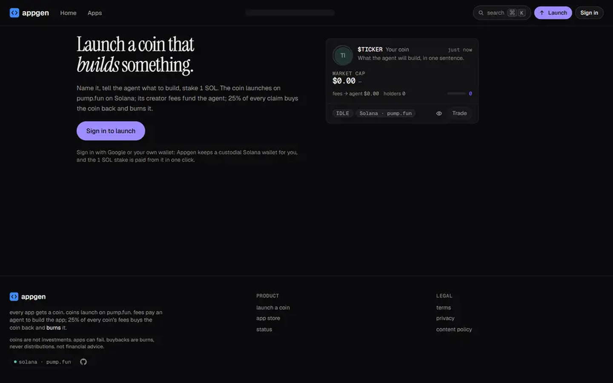

# prompt-to-app-platform

A platform that turns a one-sentence prompt into a hosted web app. Each app is paired with a coin; the coin's creator fees pay for an AI agent (the Claude Agent SDK, running inside an E2B microVM) that builds the app, deploys it and keeps iterating on it.

The code calls the product "Appgen". It is an npm-workspaces TypeScript monorepo: an Express API, BullMQ workers, a Prisma/Postgres schema, a chain package with venue adapters for pump.fun on Solana and PONS v2 on Robinhood Chain, a browser SDK for generated apps, and a React 19 + Vite front end.



## How an app gets built

1. **Intake.** The `intake` worker moderates the prompt and turns it into a spec (purpose, audience, MVP list, optional holder tier). The launcher approves the spec before anything is created.
2. **Launch.** The `launch` worker creates the coin through `adapterFor(launchpad)` in `@appgen/chain`, from a wallet derived for that app. A refundable stake (`LAUNCH_STAKE_BY_CHAIN`) is the spam control and is returned at the first build.
3. **Fees.** Every 5 minutes the `feeSweep` worker claims the app's creator fees and splits them with `splitFees` in `@appgen/shared`. Most of each claim becomes the app's build budget; the rest goes to the launcher and to a per-coin ledger account.
4. **Build.** Once the budget clears the threshold, the scheduler enqueues a build. `apps/runner/src/build` starts an E2B sandbox from the `appgen-builder` template, copies in `template/`, and runs the agent against it. The output has to pass `npm run build`, a Playwright smoke test, screenshots and a reviewer model before `deploy.ts` publishes it.
5. **Hosting.** The API serves each app on its own subdomain (`apps/api/src/host`). Server functions run in a QuickJS sandbox with CPU and memory limits, and model calls go through an Anthropic proxy that charges each job against its own budget token.
6. **Reconcile.** Every 5 minutes the `reconcile` worker checks jobs, sandboxes, job tokens, payouts, the ledger and escrow claims for drift and writes a `ReconcileRun` row per check.

Generated apps never contain auth, wallet or network code. The template's lint rules ban `fetch`, `XMLHttpRequest`, `WebSocket` and `eval`, and apps reach platform features (auth, KV, functions, LLM calls, holder gate) only through `@appgen/app-sdk`.

## Layout

```
packages/shared     fee split, budgets, zod schemas, DTO types
packages/db         Prisma schema, migrations, client
packages/chain      venue adapters (venue.ts): Robinhood Chain on viem, Solana/pump.fun on web3.js
packages/app-sdk    browser SDK used by generated apps
apps/api            Express API, SSE feeds, Anthropic budget proxy, app hosting, QuickJS runtime
apps/runner         BullMQ workers: intake, launch, build, PR review, fee sweep, buyback,
                    price, holders, market, credits, monitor, growth, reconcile
apps/web            React 19 + Vite front end
template/           the app template the agent builds inside
```

## Getting started

Requires Node 22 or newer (CI and the Dockerfiles use Node 24).

```bash
npm ci
npm run db:generate
npm run build      # shared, db, chain, app-sdk, api, runner, web
npm test           # vitest; no network or database needed
```

`npm run typecheck:tests` typechecks the API and runner test suites.

To run the services, copy `.env.example` to `.env` and fill it in. Both services need `DATABASE_URL`, `REDIS_URL`, `PLATFORM_MASTER_SEED_HEX` and `ANTHROPIC_API_KEY`. The API also needs `GOOGLE_CLIENT_ID` and `RPC_URL`; the runner also needs `E2B_API_KEY` and `GITHUB_TOKEN`. The Solana venue is enabled only when `SOLANA_RPC_URL` is set. Then:

```bash
npm run db:migrate
npm run dev:api
npm run dev:runner
npm run dev:web
```

The web app builds and renders without a backend (`npm run build -w @appgen/web`, then `npx vite preview` in `apps/web`), but feeds and sign-in need the API.

Each of `apps/api`, `apps/runner` and `apps/web` has a Dockerfile and a `railway.json`.

## Operations

- `PlatformSetting.pause_builds = true` stops all builds; `pauseFeeSweep` and `pauseBuyback` stop money movement.
- `node apps/web/scripts/audit.mjs` builds the web app, serves it with `server.mjs` and checks bundle size, performance, accessibility and headers against a running API.
- `apps/api/scripts/security-check.mjs` probes a deployed API's perimeter; `probe-intake.mjs` pushes one prompt through intake.

## CI

`.github/workflows/ci.yml` installs from the lockfile, generates the Prisma client, builds every package, typechecks all packages and the test suites, runs the tests, builds the apps, and checks that the Prisma migrations match `schema.prisma` against a Postgres service container.

## License

MIT. See [LICENSE](LICENSE).
